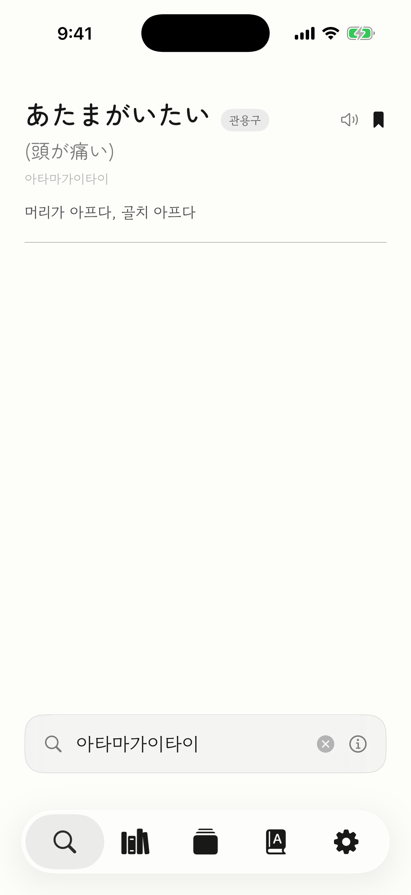
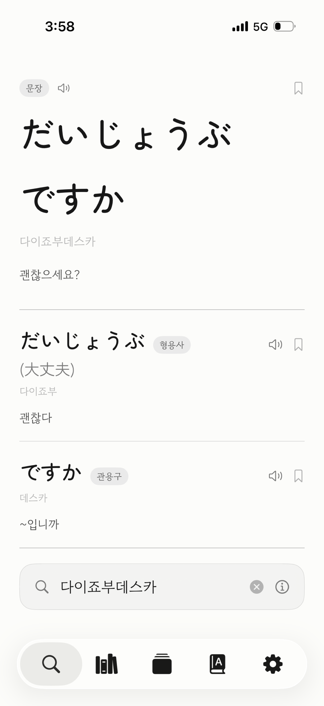
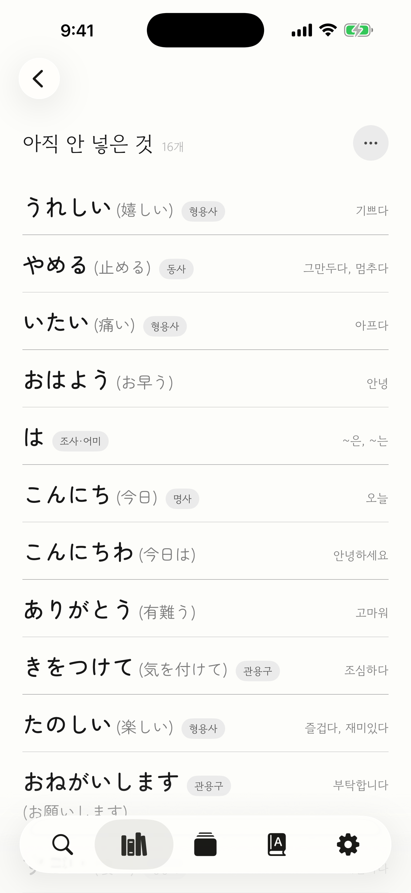
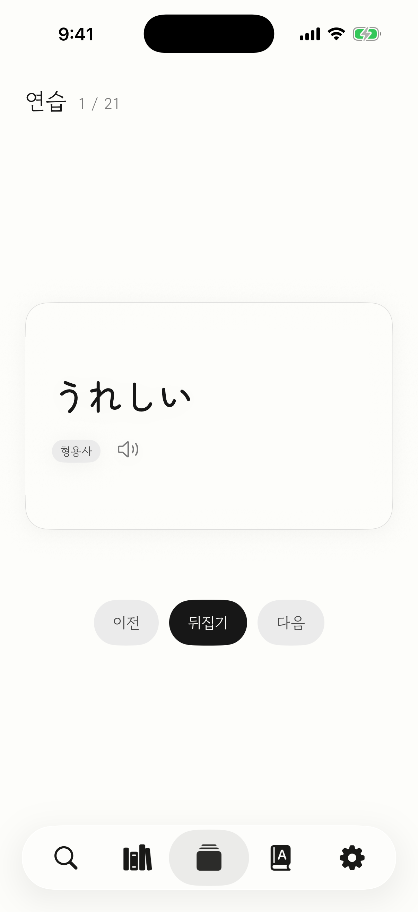
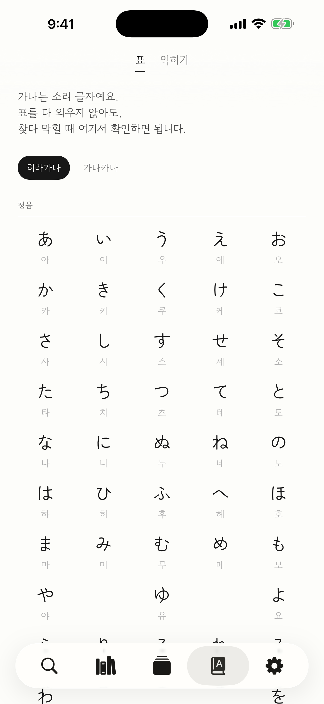

# 뭐라고

일본어를 **들리는 대로 한글로 치면** 원래 일본어를 찾아 주는 iPhone 앱.

애니를 보다 걸린 대사 한 마디를 소리 그대로 쳐서 찾고, 담아 두고, 다시 연습한다.
가나를 못 읽어도 되고 띄어 쓰지 않아도 된다.

```
아타마가이타이   →  頭が痛い      머리가 아프다
다이죠부데스카   →  大丈夫ですか  大丈夫 · です · か
이타이야메로     →  痛い 止める   아프다 · 그만두다
```

## 화면

<table>
  <tr>
    <td align="center" width="20%"></td>
    <td align="center" width="20%"></td>
    <td align="center" width="20%"></td>
    <td align="center" width="20%"></td>
    <td align="center" width="20%"></td>
  </tr>
  <tr>
    <td align="center"><b>찾기</b><br><sub>들린 대로 치면<br>원문이 나온다</sub></td>
    <td align="center"><b>문장</b><br><sub>조각으로 갈라 주고<br>문장 뜻까지</sub></td>
    <td align="center"><b>책장</b><br><sub>담은 것이<br>교재가 된다</sub></td>
    <td align="center"><b>연습</b><br><sub>가나를 보고<br>뜻을 떠올린다</sub></td>
    <td align="center"><b>글자</b><br><sub>막히면<br>오십음도</sub></td>
  </tr>
</table>

## 쓰는 법

1. **찾기** — 들린 소리를 한글로 친다. 문장이면 낱말 조각으로 갈라서 보여 준다.
2. **담기** — 카드의 갈피표를 누르면 책장에 담긴다. 화별로 묶음을 만들어 둘 수 있다.
3. **연습** — 담은 낱말이 카드가 된다. 가나를 보고 뜻을 떠올린 뒤 뒤집는다.
4. **글자** — 가나를 모르면 오십음도 탭에서 확인한다.

정확히 옮겨 적지 않아도 된다. 아래는 어느 쪽으로 쳐도 같은 낱말에 닿는다.

| 신경 쓰지 않아도 되는 것 | 예 |
|---|---|
| 길게 끄는 소리 | `아리가토` · `아리가토우` → 有難う |
| 받침 ㄴ · ㅁ · ㅇ | `센빠이` · `셈빠이` → 先輩 |
| 작은 っ | `잇쇼` → 一緒 |
| 죠 · 조 | `쇼죠` · `쇼조` → 少女 |
| つ | `츠쿠에` · `쓰쿠에` → 机 |

**탁음만은 들리는 대로 가려 친다** — `갓코`(学校)와 `캇코`(格好)는 다른 낱말이다.

사전은 앱 안에 들어 있어 인터넷 없이 돈다. 문장 뜻은 iOS 번역 기능을 쓰므로
설정 › 일반 › 언어 및 지역 › 번역 언어에서 일본어를 받아 두어야 나온다.

## 빌드

Xcode 26 · iOS 18 이상 · [XcodeGen](https://github.com/yonaskolb/XcodeGen) 이 필요하다.

사전 색인과 빈도 목록은 크기 때문에 저장소에 없다.
[mworago-data 릴리스](https://github.com/G1G1M/mworago-data/releases/latest)에서 받는다.

```sh
# 1. 자료 받기
mkdir -p MworagoApp/Resources
for f in mworago-dict.db jesc_freq.tsv; do
  curl -L -o MworagoApp/Resources/$f \
    https://github.com/G1G1M/mworago-data/releases/latest/download/$f
done
./Tools/fetch/fetch-fonts.sh
./Tools/fetch/fetch-hanja.sh

# 2. 프로젝트 만들고 열기
xcodegen generate
open Mworago.xcodeproj
```

실기기에 올리려면 `project.yml` 의 `DEVELOPMENT_TEAM` 을 자기 팀으로 바꾼다.
시뮬레이터에는 일→한 번역 언어팩이 없어 문장 뜻은 실기기에서만 보인다.

## 자료와 라이선스

| 자료 | 쓰임 | 라이선스 |
|---|---|---|
| [JMdict](https://www.edrdg.org/jmdict/j_jmdict.html) | 사전 | CC BY-SA 4.0 |
| [KANJIDIC2](https://www.edrdg.org/wiki/index.php/KANJIDIC_Project) | 한자 독음 | CC BY-SA 4.0 |
| [JESC](https://nlp.stanford.edu/projects/jesc/) | 낱말 빈도 | CC BY-SA 4.0 |
| Zen Maru Gothic · 고운돋움 | 글꼴 | SIL OFL 1.1 |

구운 색인과 빈도 목록은 같은 조건(CC BY-SA 4.0)으로
[mworago-data](https://github.com/G1G1M/mworago-data/releases/latest)에 공개한다.
앱 코드에는 따로 라이선스를 두지 않았다.
